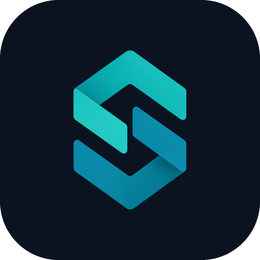

<p align="center">
  
</p>

<h1 align="center">Segra Desktop</h1>

<p align="center">
A private AI agent for your files and code. Built on <a href="https://github.com/cline/cline">Cline</a>.
</p>

<p align="center">
<a href="https://github.com/segraai/segra-desktop/releases"><strong>Download</strong></a>
&nbsp;·&nbsp;
<a href="https://web.segra.ai"><strong>segra.ai</strong></a>
</p>

---

Segra Desktop is an AI agent that works on your computer. It reads your files, edits them, runs commands and searches the web for you, and your work stays private.

- **Your work stays on your computer.** Chats, files and history are stored locally, not on someone's server.
- **Powerful models in sealed hardware.** Segra's models run inside trusted execution environments (TEEs). Before anything is sent, the app checks that the hardware is genuine and sealed, so neither the hosting company nor Segra can read your prompts or files.
- **Or fully local.** You can run a model on this computer instead. Segra Desktop bundles [llama.cpp](https://github.com/ggml-org/llama.cpp) and offers a few preselected open models, so nothing leaves your machine and it works offline. Local models are slower and simpler than Segra's.
- **A real agent.** It edits files across a project, runs shell commands, searches and fetches web pages, and supports Plan and Act modes, MCP servers and plugins.
- **Clear about what leaves your computer.** The app tells you when a tool reaches an outside service. For example, a web search is sent to the search engine, and an MCP server may connect to the service behind it.

## How it works

1. **The app runs on your computer.** It's a Tauri desktop app for macOS, Windows and Linux, with a local backend that runs the agent and its tools.
2. **The AI runs in a locked box.** With Segra's models, requests go straight from your computer to a model running in a TEE. Segra's server only starts the session and counts usage. It never sees what you send.
3. **Your computer checks the box first.** The app verifies the TEE's attestation before sending anything.
4. **Or keep it all at home.** Choose "Run it on this computer" during setup, and the app downloads a model once and runs it locally with llama.cpp. Downloaded models are kept in a shared `segra/models` folder that Segra Meetings also uses, so the two apps can share them.

You can also use Ollama, an OpenAI-compatible endpoint, or another provider from Settings → Providers.

## Download

Get the latest version from **[GitHub Releases](https://github.com/segraai/segra-desktop/releases)**:

| Platform | File |
|---|---|
| macOS (Apple Silicon and Intel) | `Segra-Desktop_<version>_universal.dmg` |
| Windows (64-bit) | `Segra-Desktop_<version>_x64-setup.exe` |
| Linux (Debian, Ubuntu) | `Segra-Desktop_<version>_amd64.deb` |
| Linux (Fedora, RHEL) | `Segra-Desktop_<version>_x86_64.rpm` |

The macOS and Windows builds aren't notarized or code-signed yet:

- **macOS:** the first launch is blocked. Open **System Settings → Privacy & Security** and click **Open Anyway**.
- **Windows:** SmartScreen warns on install. Click **More info → Run anyway**.

The app updates itself when a new version is released.

## Development

The toolchain is **Bun 1.4.2** (package manager and task runner), with **Node ≥ 22** as the runtime. Rust ≥ 1.85 is needed for the Tauri shell.

```sh
bun install
bun run build:sdk                      # build the SDK packages the app depends on

cd apps/examples/desktop-app
bun run dev                            # native window (Tauri)
bun run dev:headless                   # backend + web UI at http://localhost:3125
bun run typecheck
```

See [`apps/examples/desktop-app/README.md`](apps/examples/desktop-app/README.md) and [`apps/examples/desktop-app/sidecar/ARCHITECTURE.md`](apps/examples/desktop-app/sidecar/ARCHITECTURE.md) for details.

### Repository layout

| Path | What it is |
|---|---|
| `apps/examples/desktop-app` | Segra Desktop: Tauri shell (`src-tauri`), backend (`sidecar`), Next.js UI (`webview`) |
| `sdk/packages` | The agent SDK (`@cline/shared`, `llms`, `agents`, `core`, `sdk`), including the Segra and local model providers |
| `apps/cline-hub`, `apps/cli` | The hub daemon and CLI that the desktop app bundles to run sessions |

Other folders come from the upstream Cline monorepo.

### Releasing

Bump `version` in `apps/examples/desktop-app/package.json` and `src-tauri/tauri.conf.json`, push, then push a tag `segra-desktop-v<version>`. The [`segra-desktop-release`](.github/workflows/segra-desktop-release.yml) workflow builds all three platforms and publishes the GitHub release.

## Built on Cline

Segra Desktop is a fork of **[Cline](https://github.com/cline/cline)**, the open source coding agent by Cline Bot Inc. The agent runtime, tools, SDK and much of the desktop app come from Cline. Segra adds TEE-attested private models, built-in local models, the privacy UI and its own branding. Many thanks to the Cline team and contributors.

## License

[Apache 2.0](./LICENSE). Segra Desktop is a modified version of Cline, which is also licensed under Apache 2.0.
